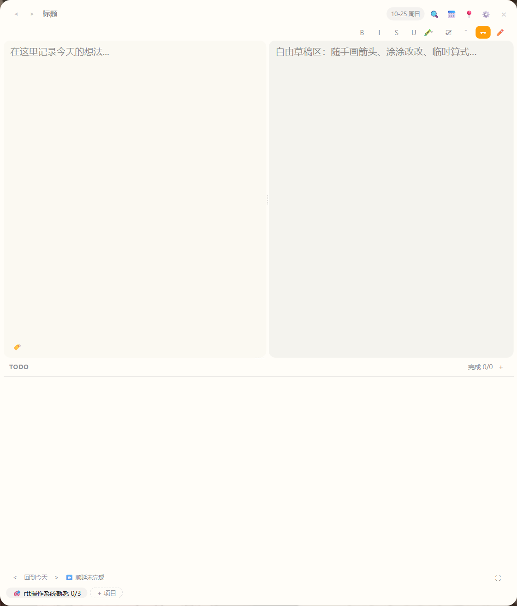
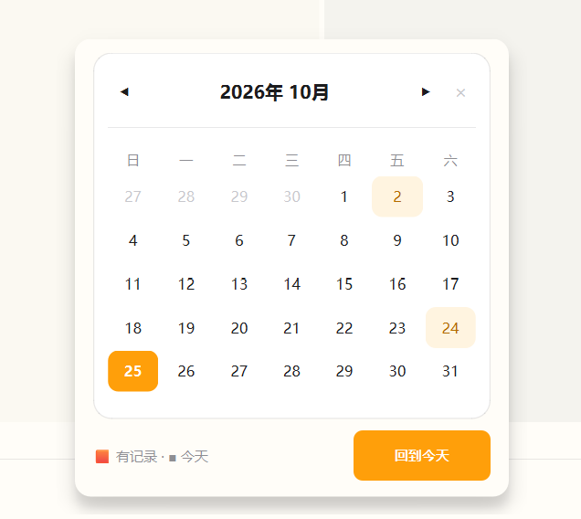

<div align="center">

# Engineer Desk

**面向工程师的桌面便签工作台** —— 日常记录、待办、项目管理与工程小工具的本地一体化入口


*所有数据存本地 SQLite，不依赖任何云服务*

</div>

---

<!-- 演示区：建议后续录一段 10s 的 GIF 操作演示放这里，效果远胜静态图 -->

## 界面一览

| 双面板便签 | 项目进度 |
|---|---|
|  |  |

| 日历 | |
|---|---|
|  | *待补：草图画板 · 波形生成器* |

## 功能

### 便签与记录
- **富文本便签**：加粗 / 斜体 / 删除线 / 下划线 / 荧光笔高亮 / 待办行（☐↔☑）/ 分割线
- **粘贴截图**：剪贴板图片直接 Ctrl+V 内嵌进笔记（base64 随笔记存储，无需图片文件夹）
- **链接自动识别**：粘贴的网址自动变为可点击链接，Ctrl+单击 在浏览器打开
- **分块归档**：分割线划分内容块，右键可将整块归档到对应项目
- **双面板**：左侧正文（可归档）+ 右侧自由草稿区
- **自动保存**：内容变更即存 SQLite，历史记录可回溯

### 待办与项目管理
- Todo 列表、标签栏、项目胶囊条与进度追踪
- 日历 / 历史记录 / 全局搜索 / 设置（深色主题、开机启动、系统托盘）

### Engineer Sketch · 草图画板（内嵌 Excalidraw）
- 便签格式栏 ✏️ 打开，系统浏览器全功能手绘白板（完全本地运行）
- **波形生成器**：PWM（单路 / 互补 + 死区）与三角波（向上 / 中央对齐 / 向下），单击放置、拖拽定大小，双击波形可回填参数原位重生成

## 运行

```bash
pip install -r requirements.txt
python main.py
```

## 打包

```bash
build.bat        # PyInstaller 打包（含草图板静态资源）
```

## 目录结构

```
src/
├── ui/            # 主窗口 / 设置 / 托盘 / 主题
├── widgets/       # 便签编辑器 / Todo / 日历 / 搜索 / 项目管理等控件
├── services/      # 自动保存 / 配置 / 本地 HTTP 服务（草图板）
└── ...
sketch-app/        # Engineer Sketch 前端源码（Vite + React + Excalidraw）
docs/              # 设计稿、实现说明与截图
Roadmap.md         # 版本路线图
```

## Roadmap 摘要

- **V1.x**：便签基础框架 → 日历 / 搜索 / 设置 → 备份 / 深色主题
- **V2.0**：工程师工具箱（ADC / 分压 / PWM / Buck / Boost 计算）+ 草图画板与波形生成器
- **V3.0**：个人工程知识库（代码片段、经验积累、快速启动）

详见 [Roadmap.md](Roadmap.md)。
